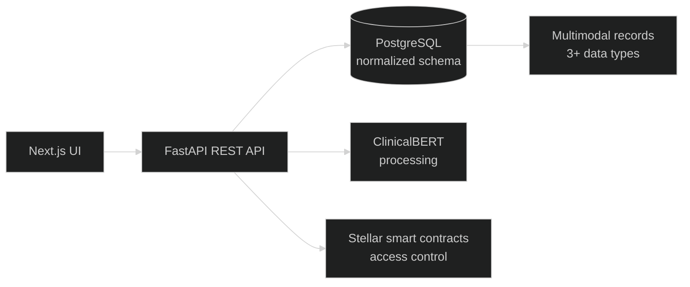
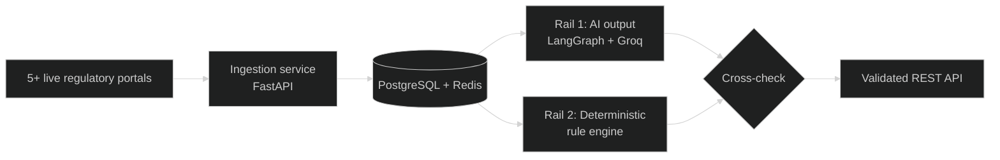
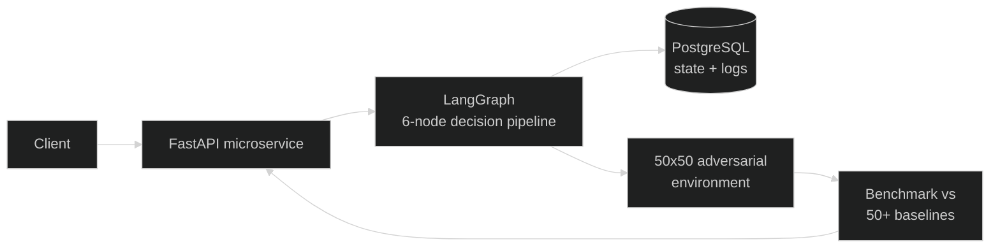
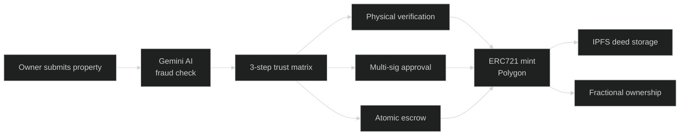

<!-- ===================== HEADER ===================== -->
<p align="center">
  
</p>

<p align="center">
  
</p>

<p align="center">
  
  
  
  
</p>

<p align="center">
  <a href="https://www.linkedin.com/in/venkatesh-reddy-k-6aba34333/"></a>
  <a href="mailto:reddy07venkatesh@gmail.com"></a>
  
</p>

<!-- ===================== STAT STRIP ===================== -->
<p align="center">
  
  
  
  
  
</p>

---

<p align="center">
  
</p>

```yaml
name        : Venkatesh Reddy K
role        : SDE Intern @ Soven Developer
founder     : Heapify Global Community (900+ members, 15+ events)
college     : Ramaiah Institute of Technology, Bangalore
degree      : B.E. Information Science & Engineering (2024–2028)
cgpa        : 9.45 / 10.00
location    : Bangalore, India 🇮🇳
focus_areas : [Backend Systems, Full Stack, Agentic AI, Blockchain]
philosophy  : "Structured. Maintainable. Scalable."
```

- 💻 Shipping **FastAPI + PostgreSQL + Next.js** systems in production at **Soven Developer**
- 🌐 Founded **Heapify Global Community**, a **900+ member** tech community with collaborations including **Google Gemma** and **Kaggle**
- ⛓️ Building decentralized systems with **Solidity, IPFS, Stellar and ZK primitives**
- 🤖 Designing **agentic pipelines** with LangGraph and RL environments
- 🏆 Hackathon **winner**, two-time **runner-up**, **IISc CP Rank 23**

---

<p align="center">
  
</p>

<div align="center">

**Languages**
<br/>
[](https://skillicons.dev)

**Frontend & Backend**
<br/>
[](https://skillicons.dev)

**Databases**
<br/>
[](https://skillicons.dev)

**DevOps & Tools**
<br/>
[](https://skillicons.dev)

</div>

---

<p align="center">
  
</p>

<!-- ===================== MEDICHAIN ===================== -->
<p align="center">
  
</p>

| | |
|---|---|
| 🎯 **Problem** | Medical records arrive in many formats (reports, scans, AI-generated treatment data) and need secure, structured storage with controlled access. |
| 🛠️ **Solution** | Full-stack platform: **Next.js** frontend, **FastAPI** backend, **normalized PostgreSQL** schema for **3+ multimodal clinical data types**, **ClinicalBERT** for medical text processing. |
| 🔐 **Security** | Blockchain-backed access control via **Stellar smart contracts**. |
| 🚢 **Delivery** | REST APIs connecting clinical data flows end-to-end, **Docker** containerization, CI-driven deployment pipeline. |




<br/>

<!-- ===================== REGGRAPH ===================== -->
<p align="center">
  
</p>

| | |
|---|---|
| 🎯 **Problem** | Regulatory information lives on many portals, changes constantly, and AI answers over it can't be trusted blindly. |
| 🛠️ **Solution** | **Python/FastAPI** backend automating real-time ingestion from **5+ live regulatory portals** into a **PostgreSQL + Redis** data layer, exposed through clean REST endpoints. |
| ✅ **Trust layer** | **Dual-Rail validation pipeline** that cross-checks AI outputs against a **deterministic rule engine**. |
| 📈 **Impact** | Improved data quality across **100+ live queries** and cut false-positive escalations. |




<br/>

<!-- ===================== ADIRE ===================== -->
<p align="center">
  
</p>

| | |
|---|---|
| 🎯 **Problem** | Autonomous agents need a backend that is observable, benchmarkable and reliable before anything is deployed. |
| 🛠️ **Solution** | Distributed Python backend with a **FastAPI microservice layer** orchestrating a **6-node LangGraph decision pipeline** with state management. |
| 🔍 **Observability** | Structured logging and performance benchmarking built in. |
| 🛡️ **Reliability** | Validated across a **50×50 adversarial environment** and checked against **50+ historical baselines** before deployment. |




<br/>

<!-- ===================== LANDCHAIN ===================== -->
<p align="center">
  
</p>

| | |
|---|---|
| 🎯 **Problem** | Property deeds are easy to forge and hard to verify, and ownership is rarely divisible. |
| 🛠️ **Solution** | **Polygon-based dApp** tokenizing property as **ERC721** NFTs, with **fractional ownership**. |
| 🧾 **Trust matrix** | 3 steps: **physical verification + cryptographic multi-sig + atomic escrow**. |
| 🤖 **AI layer** | **Gemini** runs pre-mint fraud detection; deeds are stored immutably on **IPFS**. |




<p align="center">
  <a href="https://github.com/VenkateshReddy007?tab=repositories"></a>
</p>

---

<p align="center">
  
</p>

<p align="center">
  
</p>

| 👥 Members | 🎪 Events | 🏟️ Format | 🤝 Collaborations |
|:---:|:---:|:---:|:---:|
| **900+** | **15+** | **National-level hackathons** and more | **Google Gemma**, **Kaggle** |

I started Heapify in 2026 to give students a place to build, compete and learn together. It grew from a campus idea into a 900+ member community running national-level events.

---

<p align="center">
  
</p>

| Role | Organization | Period |
|---|---|---|
| 💻 SDE Intern | **Soven Developer** | Aug 2026 – Present |
| 🌐 Founder | **Heapify Global Community** | 2026 – Present |

**Soven Developer**
- Built and maintained scalable **FastAPI + PostgreSQL** services, designing normalized schemas and optimized SQL to reduce API latency on core endpoints
- Shipped full-stack features with **Next.js** and **FastAPI**, integrating REST APIs end-to-end with clean-code and OOP principles
- Ran code reviews, debugged cross-service issues, applied security best practices for data integrity, and contributed to architecture and **Git + Docker** deployment workflows

---

<p align="center">
  
</p>

| 🎖️ Event | Result | Year |
|---|---|---|
| Innovex 2.0 Hackathon (Bangalore City University) |  | 2026 |
| Agentathon, RIT TechFest |  | 2026 |
| Altaria National Hackathon (Blockchain + AI), DSCE |  | 2026 |
| IISc Bangalore CP Contest (CSA) |  | 2026 |
| ISpy (CTF + Treasure Hunt), RIT TechFest |  | 2026 |
| NMIT Hacks |  | 2026 |
| Limitless Minds Hackathon |  | 2025 |

---

<p align="center">
  
</p>

<p align="center">
  
</p>

<p align="center">
  
</p>

---

<p align="center">
  
</p>

<p align="center">
  
</p>

<p align="center">
  
  
</p>

<p align="center">
  
</p>

<p align="center">
  
</p>

---

<p align="center">
  
</p>

- 🔭 Scaling backend systems and agentic pipelines
- 🌱 Going deeper into ZK primitives and reinforcement learning
- 🌐 Growing **Heapify** past 1000 members
- 🤝 Open to **internships, hackathon teams and open-source collabs**
- 💬 Ask me about: FastAPI, LangGraph, Solidity, DSA, building communities

---

<p align="center">
  
</p>

<p align="center">
  <a href="https://www.linkedin.com/in/venkatesh-reddy-k-6aba34333/"></a>
  <a href="mailto:reddy07venkatesh@gmail.com"></a>
  <a href="https://github.com/VenkateshReddy007"></a>
</p>

<p align="center"><i>"Engineering intelligence, one system at a time."</i></p>

<p align="center">
  
</p>
